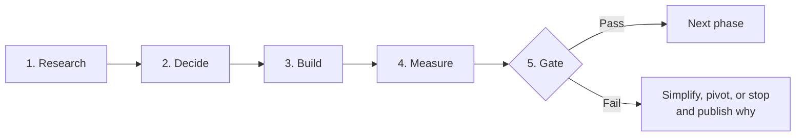

# ZEMA — Master Research & Build Prompt

## The Post-Browser Application Platform

> **The Reading Age is over. The Service Age has begun.**

| Field | Detail |
|---|---|
| **Document** | ZEMA — Master Research & Build Prompt |
| **Version** | 1.1 (improved and recorded edition) |
| **Date** | 2026-11-01 |
| **Status** | Draft — ready for Phase 0 review and freeze |
| **Location** | `docs/zema-master-prompt/ZEMA-Master-Research-and-Build-Prompt.md` |
| **Canonical copy** | This file is the single source of truth. Do not maintain parallel copies. |

> **Evidence note on the original subtitle:** Earlier drafts called ZEMA
> *"the world's first post-browser platform."* Under this project's own
> evidence discipline (see [Evidence labels](#evidence-labels)), that claim
> is a **Hypothesis**, not an established fact. It may be used as an
> aspiration, but it must not be presented as proven until the Phase 0
> prior-art review is complete and recorded.

---

## Table of Contents

- [1. Vision & Framing](#1-vision--framing)
- [2. How to Use This Prompt](#2-how-to-use-this-prompt)
- [3. Guiding Principles](#3-guiding-principles)
- [Phase 0 — Historical Foundations & Problem Definition](#phase-0--historical-foundations--problem-definition)
- [Phase 1 — The Unified Language: "Plain"](#phase-1--the-unified-language-plain)
- [Phase 2 — Reactive State Model](#phase-2--reactive-state-model)
- [Phase 3 — Execution Model & Host Isolation](#phase-3--execution-model--host-isolation)
- [Phase 4 — Memory Safety & Concurrency](#phase-4--memory-safety--concurrency)
- [Phase 5 — Security: Capability-Enforced by the Host](#phase-5--security-capability-enforced-by-the-host)
- [Phase 6 — UI, Rendering & Layout](#phase-6--ui-rendering--layout)
- [Phase 7 — Text & Internationalization](#phase-7--text--internationalization)
- [Phase 8 — Accessibility (Release Gate)](#phase-8--accessibility-release-gate)
- [Phase 9 — Data: Local-First Correctness, Recovery & Replication](#phase-9--data-local-first-correctness-recovery--replication)
- [Phase 10 — Networking & Protocol Discipline](#phase-10--networking--protocol-discipline)
- [Phase 11 — Delivery, Identity, Updates & Adoption](#phase-11--delivery-identity-updates--adoption)
- [Phase 12 — Performance Benchmarking & Evidence Discipline](#phase-12--performance-benchmarking--evidence-discipline)
- [Phase 13 — Developer Experience (Measured Honestly)](#phase-13--developer-experience-measured-honestly)
- [Phase 14 — Production Readiness & Scope Discipline](#phase-14--production-readiness--scope-discipline)
- [One-Sentence Summary](#one-sentence-summary)
- [Research Book Cross-Reference](#research-book-cross-reference)
- [Appendix A — Glossary](#appendix-a--glossary)
- [Appendix B — What to Record, and Where](#appendix-b--what-to-record-and-where)
- [Appendix C — Version History](#appendix-c--version-history)

---

## 1. Vision & Framing

The browser was invented to *read documents*. It succeeded spectacularly:
URLs, links, search, standards, accessibility APIs, developer tools,
security origins, and a universal installed base.

The modern web, however, has bolted an entire application platform onto a
document renderer — the DOM, CSS layout, JavaScript event loops,
WebGL/WebGPU, WebAssembly (Wasm), service workers, and Progressive Web
Apps (PWAs). The result is a stack of mismatched layers — markup, style,
client code, server code, schemas, queries, build tooling, and deployment
configuration — that imposes enormous coordination costs, wastes
resources, and still struggles with responsiveness, security, and
accessibility.

**ZEMA** is a research-and-build project to create a true **post-browser
application platform**: a deliberately constrained, capability-secured
client runtime with one co-designed language — **"Plain"** — that replaces
the browser *for a defined class of interactive, data-driven service
applications*. It does **not** attempt to replace the browser for general
document browsing.

### The core bet

An integrated language + runtime + state model + UI pipeline can deliver a
*measurably* better combination of developer effort, responsiveness,
resource use, security, accessibility, and distribution than comparable
web and native alternatives.

### The method

Research in depth, from the oldest concepts to the newest. Record
everything. Build one component at a time. Reuse what exists. Invent only
where existing solutions provably fail. Prove every claim with gated,
reproducible experiments.

---

## 2. How to Use This Prompt

Work through the phases **in order**. For each phase, execute the full
loop below. Do not skip the gate.

### The five-step loop

1. **RESEARCH** — Study the historical lineage and the current state of
   the art in depth. Record findings with citations.
2. **DECIDE** — For each sub-component, evaluate *build vs. reuse vs.
   invent*. Document the decision, including its security and performance
   cost, in a decision record.
3. **BUILD** — Implement the smallest verifiable slice that can test the
   decision.
4. **MEASURE** — Benchmark against the baseline specified for the phase.
   Record the raw data, not only the summary.
5. **GATE** — Pass or stop. Every gate can terminate the project.
   *"An existing web, PWA, Wasm, or native solution meets this problem
   better"* is a valid and honorable outcome.

### Evidence labels

Label **every** claim in every record with exactly one of the following:

| Label | Meaning |
|---|---|
| **Established** | Backed by a cited external source. |
| **Proposed** | A design decision that has been made but not yet implemented or verified. |
| **Hypothesis** | Needs a measurement or a formal proof before it can be trusted. |

Unlabeled claims must be treated as **Hypotheses**.

### Language conventions

The key words **MUST**, **MUST NOT**, **SHOULD**, **SHOULD NOT**, and
**MAY** in this document are to be interpreted as described in
[RFC 2119](https://www.rfc-editor.org/rfc/rfc2119).

### Recording rules

- Every research finding, decision, experiment, and gate review **MUST**
  be recorded in the repository (see
  [Appendix B](#appendix-b--what-to-record-and-where)).
- Records **MUST** include: date, author, evidence label, sources or raw
  data, and the gate or phase they belong to.
- Negative results **MUST** be recorded with the same care as positive
  results. A retracted claim is a successful experiment, not a failure of
  record-keeping.

### Gate naming (normalized in v1.1)

Each phase ends with exactly one gate of the same number:
**Phase 0 → Gate 0, Phase 1 → Gate 1, …, Phase 14 → Gate 14.**

Four gates are additionally **milestone gates** because they can block a
release on their own:

| Milestone gate | Why it can block a release |
|---|---|
| **Gate 8 — Accessibility Release Gate** | Accessibility gaps block release. No exceptions. |
| **Gate 11 — Delivery Gate** | An app that cannot be installed, updated, and trusted cannot ship. |
| **Gate 12 — Evidence Gate** | No headline claim may ship unverified. |
| **Gate 14 — Production Gate** | Final go / no-go decision for the first release. |

> Earlier drafts used a second, overlapping numbering (Gate 2 = Phase 8,
> Gate 3 = Phase 11, Gate 4 = Phase 12, Gate 5 = Phase 14). That dual
> numbering has been removed to avoid ambiguity. See `IMPROVEMENTS.md`
> for the mapping.

---

## 3. Guiding Principles

These principles are drawn from the phases below. Where a principle and a
phase instruction appear to conflict, the phase instruction governs, and
the conflict **MUST** be recorded as a decision.

1. **Correct before fast.** A measured slow system can be optimized; an
   unmeasured "fast" claim cannot be trusted.
2. **Reuse before invent.** Invention requires evidence that existing
   solutions provably fail for ZEMA's defined app class.
3. **One workload, one OS, first.** Scope is a feature (see Phase 14).
4. **Types give auditability; the host gives authority.** Language-level
   effects never substitute for host-enforced capabilities.
5. **Accessibility is a release criterion**, not a feature to add later.
6. **No claim without a baseline, and no baseline without raw data.**
7. **Every gate can stop the project** — including the final one.

---

## Phase 0 — Historical Foundations & Problem Definition

*From the Reading Age to the Service Age: understand what the browser got
right before replacing any part of it.*

### Purpose

Define the problem precisely, name what ZEMA will **not** do, and account
honestly for everything the browser already provides.

### Historical lineage (oldest → newest)

- Hypertext and URLs (Bush, 1945; Engelbart, 1968; Berners-Lee, 1989)
- The document browser model (Mosaic, 1993; Netscape; Internet Explorer)
- The browser as an accidental application platform (DHTML → Ajax → SPAs)
- The modern web stack (Wasm, WebGPU, HTTP/3, PWAs, CSP)
- Native application platforms (iOS, Android, desktop toolkits)
- Prior post-browser attempts (Electron, Tauri, Flutter, React Native)

### Research tasks

- [ ] Catalog every service the browser provides beyond rendering:
  distribution (URLs and links), security (origins, isolation, CSP,
  updates), accessibility APIs, developer tools, search indexing, and
  its installed base.
- [ ] Classify each service as **rebuild**, **interoperate**, or
  **admit giving up** — and record the cost of that choice.
- [ ] Define the exact class of applications ZEMA targets (interactive,
  data-driven services) and the class it explicitly does **not** target
  (general document browsing, arbitrary HTML rendering).
- [ ] Document the coordination cost of today's fragmented stack (markup
  \+ style + JavaScript + server + schema + query + build + deploy).

### Build tasks

- [ ] Write a one-page problem statement with explicit non-goals: no
  general browsing, no arbitrary HTML, no new internet protocol, no full
  offline collaboration, and no every-OS first prototype.
- [ ] Create the evidence register (template provided in
  `templates/evidence-register.md`).

### Deliverables to record

- Problem statement (one page, frozen at Gate 0)
- Browser-services catalog with rebuild / interoperate / give-up decisions
- Evidence register, populated with all claims made so far — including
  the "world's first" claim, labeled **Hypothesis**

### Gate 0 — Exit criteria

- [ ] Problem statement is reviewed and frozen.
- [ ] Target app class is defined with concrete examples, starting with
  the **task list app**.
- [ ] Non-goals are documented and agreed.

---

## Phase 1 — The Unified Language: "Plain"

*One small, easy, typed application language, co-designed with its
runtime, state model, and UI.*

### Purpose

Specify the smallest language that can express the target app class
safely and readably — and freeze it for this gate.

### Historical lineage

- ALGOL / Pascal — structured programming, strong typing
- ML / Haskell — type inference, algebraic data types, pattern matching
- Rust — ownership, no null, `Result`/`Option`, explicit mutability
- Swift / Kotlin — modern ergonomics, tagged unions, exhaustive matching
- Elm — no runtime exceptions, friendly errors, an opinionated architecture
- Unison / Val — capability-based effects, value semantics

### Research tasks

- [ ] Study the "easy" specification in depth: a small core, one
  notation per feature before syntactic sugar, readable diagnostics with
  error spans, predictable behavior, and local type inference with
  annotations required at public boundaries.
- [ ] Research the type system: immutable `let` with explicit `mut`,
  records, tagged unions, exhaustive matching, `Option`/`Result` (no
  null, no unchecked exceptions), and checked integer overflow.
- [ ] Catalog the honest limits: unified syntax still contains multiple
  semantic domains (queries, layout, text, GPU). One language removes
  *seams*; it does not eliminate *domain complexity*.
- [ ] Study the deferred features and **why** each is deferred:
  algebraic effect handlers, refinement types / SMT solving, const
  generics, hygienic macros, content-addressed modules, a query DSL,
  CRDTs, LLVM/Wasm/custom-VM back ends, and self-hosting.

### Build tasks

- [ ] Draft the normative grammar and indentation rules.
- [ ] Specify Unicode identifier handling and confusable detection.
- [ ] Define evaluation order and overflow, division, and floating-point
  behavior.
- [ ] Specify closures and capture semantics; generic bounds; nominal
  vs. structural interfaces and coherence; and alias vs. newtype.
- [ ] Define `?` error propagation and `defer` cleanup semantics.
- [ ] Set inference limits explicitly. (No unqualified promise of "full
  Hindley–Milner plus everything.")
- [ ] Build a small-step operational semantics and a conformance test
  suite.
- [ ] Resolve all draft ambiguities catalogued in §12.1 of the research
  book (see [cross-reference](#research-book-cross-reference)).

### Reuse vs. invent

**Invent (the novel bet):** the co-design of language + reactive state +
UI layout in a single typed surface. No existing language does this
without macros or code generation. Everything else in this phase should
follow established language-design practice.

### Deliverables to record

- Normative grammar and semantics document
- Conformance test suite with passing results
- Deferred-features list, each with a recorded reason

### Gate 1 — Exit criteria

- [ ] A safe executable core language is running (interpreter or
  compiled).
- [ ] The conformance suite passes for all specified semantics.
- [ ] Syntax is frozen for this gate. Scope discipline: no feature creep.

---

## Phase 2 — Reactive State Model

*Correct before it is fast. Static wiring where provable; explicit
tracking where dynamic.*

### Purpose

Define how state changes propagate — with no glitches, no stale reads,
and no blanket performance promises.

### Historical lineage

- Dataflow languages (Lustre, Esterel, 1980s)
- Spreadsheet recalculation engines (VisiCalc, 1979 → Excel)
- Functional reactive programming (FRP; Conal Elliott, 1997)
- Reactive Extensions (Rx, 2011)
- Modern signals (SolidJS, Preact Signals, Angular Signals, Svelte 5 runes)
- Incremental computation (Adapton, self-adjusting computation)

### Research tasks

- [ ] Study static dependency wiring: compile-time-known graphs vs.
  data-dependent branches, collections, and higher-order calls.
- [ ] Research the *diamond problem* (glitched views that mix old and
  new values) and all known solutions.
- [ ] Study transactional update models: queue writes → update derived
  nodes once, in dependency order → reject cycles.
- [ ] Investigate stable keys and cleanup for list items.
- [ ] Specify equality semantics, reentrancy behavior, and error
  propagation in reactive graphs.
- [ ] Research the cost model: the cost of a reactive update is
  proportional to the affected work. **There is no blanket O(1)
  promise.**

### Build tasks

- [ ] Implement a static dependency graph with compile-time wiring.
- [ ] Implement a transactional update queue with topological ordering.
- [ ] Implement cycle detection and rejection.
- [ ] Build **experiment E1**: measure reactive update cost vs. affected
  node count, and compare against web-framework baselines.

### Reuse vs. invent

**Possibly invent (experiment only):** a tracked dynamic-dependency
mechanism for data-dependent branches. This is an experiment to be
measured, not a feature to be assumed.

### Deliverables to record

- Reactive semantics specification (equality, reentrancy, errors, cycles)
- **E1** experiment record with raw data and baselines

### Gate 2 — Exit criteria

- [ ] Reactive state passes correctness tests: no glitches, no stale
  reads, cycles rejected.
- [ ] E1 measurements are recorded with raw data.
- [ ] No performance claim is made without an equivalent-workload
  baseline.

---

## Phase 3 — Execution Model & Host Isolation

*Interpreter vs. Wasm engine vs. custom VM — a decision that must be
priced in security, not only in speed.*

### Purpose

Choose how untrusted Plain code executes, and prove that a misbehaving
app can be stopped without harming other apps or the host.

### Historical lineage

- Bytecode interpreters (JVM, 1995; CPython; Lua)
- JIT compilation (HotSpot, V8, JavaScriptCore)
- WebAssembly (2017; Wasm MVP → Wasm GC → Component Model)
- Sandboxed runtimes (NaCl, gVisor, Firecracker microVMs)
- Capability hardware (CHERI, CHERI-RISC-V)

### Research tasks

- [ ] Evaluate three paths, each with a written security-cost analysis:
  - **Path A:** A small checked interpreter in Rust (provisional first
    step).
  - **Path B:** Embed a mature Wasm engine (e.g., Wasmtime, Wasmer).
  - **Path C:** Invent a custom bytecode VM — noting that a new verifier
    is new attack surface (bounds, control flow, stack types, budgets,
    malformed input).
- [ ] Study untrusted-code containment: quotas, timeouts, and termination
  that does not harm other apps.
- [ ] Research why raw FFI, the C ABI, and direct syscalls **MUST** be
  forbidden for untrusted guests.

### Build tasks

- [ ] Implement **Path A** (small checked interpreter) as the provisional
  runtime.
- [ ] Implement quota enforcement and timeout-based termination.
- [ ] Implement a **provisional capability broker stub** that mediates
  all host access. (The full, audited broker is Phase 5; this stub exists
  so that no code path ever bypasses mediation, even in the prototype.)

### Reuse vs. invent

**Reuse first.** Prefer a mature Wasm engine over inventing a VM. A
custom VM is a separate research track requiring its own hypothesis,
baseline, and security review (see Phase 14).

### Deliverables to record

- Decision record comparing Paths A, B, and C (security cost included)
- Isolation and termination test results

### Gate 3 — Exit criteria

- [ ] Untrusted app code runs in isolation with enforced quotas.
- [ ] Terminating a misbehaving app does not affect other apps or the
  host.
- [ ] A security review of the execution boundary is completed and
  recorded.

---

## Phase 4 — Memory Safety & Concurrency

*Ownership, aliasing, lifetimes, destruction, and race-free concurrency.*

### Purpose

Choose a memory model and a concurrency model whose guarantees can be
stated precisely — and then verified.

### Historical lineage

- Manual memory management (C/C++, `malloc`/`free`)
- Garbage collection (Lisp, 1959; Java; Go; tracing GC)
- Reference counting (Objective-C ARC, Swift, COM)
- Ownership and borrowing (Rust, 2015; affine/linear types)
- Region-based memory (MLKit, Cyclone)
- Perceus reference counting (Koka)
- Structured concurrency (Kotlin coroutines, Swift structured
  concurrency, Trio for Python)

### Research tasks

- [ ] Evaluate each memory strategy together with the obligation it
  creates:
  - Scoped arenas/regions → escape proofs
  - Reference counting / Perceus → a cycle strategy (handles can detect
    staleness but do not reclaim cycles)
  - Generational handles → generation wraparound
  - Tracing GC → pause-time and retained-memory measurement
  - Explicit graph owner + weak edges → destructor and resource cleanup
- [ ] Study concurrency models: structured scopes that own child tasks,
  cooperative cancellation at defined points, and bounded channels with
  backpressure.
- [ ] Research why no race-freedom claim is valid without a checked
  shared-memory model.

### Build tasks

- [ ] Specify and implement the chosen memory model, with escape
  analysis or cycle detection as required.
- [ ] Implement structured concurrency scopes with cooperative
  cancellation.
- [ ] Build **experiment E2**: measure allocation patterns, GC pauses
  (if any), and concurrent-task throughput.

### Reuse vs. invent

**Possibly invent:** a hybrid model — for example, generational handles
for the reactive graph plus arenas for per-frame allocations. This is an
active research area and must be treated as a **Hypothesis** until E2
data exists.

### Deliverables to record

- Memory and concurrency model specification, with stated guarantees
- **E2** experiment record with raw data

### Gate 4 — Exit criteria

- [ ] Memory safety is verified for the checked subset: no
  use-after-free, no data races.
- [ ] E2 measurements are recorded.
- [ ] The concurrency model is specified with its formal guarantees —
  and its explicit non-guarantees.

---

## Phase 5 — Security: Capability-Enforced by the Host

*Types give auditability. Authority comes only from opaque,
non-forgeable, host-issued handles.*

### Purpose

Make the host — never the app, and never the type system alone — the
enforcer of every sensitive operation.

### Historical lineage

- Access control lists (Multics, 1960s)
- Capability-based security (Hydra, 1974; KeyKOS, 1984; the E language, 1997)
- The object-capability model (Mark Miller; Caja/SES)
- The web origin model (same-origin policy, CORS, CSP)
- Modern OS sandboxing (seccomp-bpf, Landlock, `pledge`/`unveil`, the
  macOS sandbox)
- WebAssembly Component Model capabilities (in progress)

### Research tasks

- [ ] Define the threat model: apps, package bytes, remote responses,
  fonts, images, and persisted state are **all** untrusted — including
  signed-but-malicious apps.
- [ ] Study capability handle design: opaque, non-forgeable,
  host-issued, checked on every sensitive call, with attenuation and
  revocation.
- [ ] Research network security beyond domain allowlists: redirects,
  DNS rebinding, IP/port filtering, proxy handling, and TLS identity
  verification.
- [ ] Study unspoofable system permission-prompt design.
- [ ] Research bounded parsing of all app-controlled input (UI text,
  images, fonts).

### Build tasks

- [ ] Implement the full capability broker — handle issuance,
  attenuation, and revocation — replacing the Phase 3 stub.
- [ ] Implement OS-level sandboxing (process separation;
  seccomp/Landlock/`pledge` as appropriate for the target OS).
- [ ] Implement network policy enforcement: safe redirect following,
  DNS-rebinding prevention, and TLS identity verification.
- [ ] Implement bounded parsers for all untrusted input formats.

### Reuse vs. invent

**Invent (the integration):** connecting language-level effect
signatures with host-enforced capability handles. Effects in type
signatures provide *auditability*; the host enforces the *authority*.
The underlying OS sandboxing mechanisms **MUST** be reused, not
reinvented.

### Deliverables to record

- Threat model document
- Capability broker design and security audit report
- Network policy test results (redirects, DNS rebinding, TLS)

### Gate 5 — Exit criteria

- [ ] The capability broker passes a security audit.
- [ ] A malicious test app cannot escalate privileges, reach
  unauthorized resources, or harm other apps.
- [ ] Network policy enforcement is verified against DNS-rebinding and
  redirect attacks.

---

## Phase 6 — UI, Rendering & Layout

*A retained scene graph and GPU rendering, with no DOM layer. Remember:
a fast signal write is not the same as fast visible pixels.*

### Purpose

Build the pipeline from input to pixels — and measure every stage of it
separately.

### Historical lineage

- Immediate-mode GUI (X11, Win32 GDI)
- Retained-mode GUI (Mac OS QuickDraw → Cocoa, Java Swing, WPF)
- Scene graphs (Open Inventor, 1992; Qt Scene Graph; the Flutter layer tree)
- CSS layout (the box model, Flexbox, Grid)
- Constraint-based layout (the Cassowary algorithm, 1997)
- GPU rendering pipelines (OpenGL → Vulkan/Metal/DirectX 12 → wgpu)
- 2D GPU renderers (Skia, Vello/Piet, Pathfinder)
- Virtualized lists (iOS `UITableView`, Android `RecyclerView`, web
  virtual scrollers)

### Research tasks

- [ ] Study the full pipeline — input → semantic view tree → layout →
  retained scene → renderer → display — with the accessibility tree fed
  from the same semantics (see Phase 8).
- [ ] Evaluate existing rendering stacks (winit/wgpu, the Vello back-end
  family) against writing a custom GPU engine. **Strong recommendation:
  reuse maintained stacks.**
- [ ] Research CPU/software fallback requirements.
- [ ] Study layout approaches: row/column/stack (Flexbox-like) vs.
  Cassowary-style constraints. Constraints are a separate experiment and
  require specified conflict behavior.
- [ ] Research virtualized-list requirements: identity preservation,
  focus retention, scroll anchors, and off-screen accessibility.
- [ ] Define the measurement protocol, separating the event, state,
  layout, scene, and presentation stages.

### Build tasks

- [ ] Implement the semantic view tree → layout → retained scene graph
  pipeline.
- [ ] Integrate winit/wgpu with a Vello-family back end.
- [ ] Implement row/column/stack layout and virtualized lists.
- [ ] Implement a CPU/software rendering fallback.
- [ ] Build a measurement harness for each pipeline stage.

### Reuse vs. invent

**Invent (the performance bet):** the compile-time-wired connection from
reactive dependencies to the retained scene graph — no diffing, no
virtual DOM. **Reuse everything else** in the rendering stack.

### Deliverables to record

- Pipeline architecture document
- Per-stage measurement results (event / state / layout / scene /
  present), recorded separately

### Gate 6 — Exit criteria

- [ ] The retained scene graph renders correctly on GPU, with a working
  CPU fallback.
- [ ] Pipeline-stage measurements are recorded separately.
- [ ] Virtualized lists preserve identity, focus, and scroll position.

---

## Phase 7 — Text & Internationalization

*A platform requirement, not an afterthought. The world does not read
left-to-right in Latin script.*

### Purpose

Render, select, and edit the world's writing systems correctly — from
the first release, not as a later patch.

### Historical lineage

- ASCII (1963) → Unicode (1991; now more than 150,000 characters)
- Unicode algorithms: UAX #29 (segmentation), UAX #9 (bidirectional
  text), UAX #14 (line breaking)
- Text shaping (HarfBuzz, 2009; from Pango/FreeType)
- Font technologies (TrueType, OpenType, COLR/CPAL, SVG-in-OpenType)
- SDF glyph rendering (Valve, 2007; widely used in game engines)
- IME composition (CJK and other input methods)

### Research tasks

- [ ] Study Unicode text processing: segmentation (grapheme clusters,
  words, sentences), the bidirectional algorithm, and line-breaking
  rules.
- [ ] Evaluate text-shaping engines. (HarfBuzz is the proven choice.)
- [ ] Research font-fallback strategies across scripts.
- [ ] Study selection and editing by **grapheme cluster** — not by code
  point, and not by byte.
- [ ] Research IME composition handling, clipboard integration, and
  emoji/color-font rendering.
- [ ] Investigate the accuracy limits of SDF glyph rendering. (It is not
  universally accurate for all scripts.)
- [ ] Define the test matrix: Arabic, Hebrew, Indic scripts, Ethiopic,
  CJK, combining marks, mixed-direction text, and high-DPI displays.

### Build tasks

- [ ] Integrate HarfBuzz for text shaping.
- [ ] Implement Unicode segmentation (UAX #29) for selection and cursor
  movement.
- [ ] Implement bidirectional layout (UAX #9).
- [ ] Implement line breaking (UAX #14).
- [ ] Implement the font-fallback chain.
- [ ] Implement IME composition support.
- [ ] Build **experiment E4**: a rendering-accuracy test across the full
  script matrix.

### Reuse vs. invent

**Reuse.** HarfBuzz + ICU/`unicode-rs` + a proven font rasterizer should
suffice. Invent only if SDF rendering provably fails for specific
scripts in E4.

### Deliverables to record

- Script test matrix with pass/fail results per script
- **E4** experiment record with reference renderings

### Gate 7 — Exit criteria

- [ ] Every script in the test matrix renders correctly and is
  selectable and editable by grapheme cluster.
- [ ] Bidirectional text with mixed directions displays correctly.
- [ ] IME composition works for CJK input.
- [ ] E4 results are recorded.

---

## Phase 8 — Accessibility (Release Gate)

*From the first vertical slice. Not a feature — a release criterion.*

### Purpose

Ensure that the task list app — and therefore the platform's semantic
model — is fully usable with assistive technology before anything ships.

### Historical lineage

- Screen readers (JAWS, 1995; VoiceOver, 2005; NVDA, 2006; TalkBack, 2011)
- Accessibility APIs (MSAA, 1997; IAccessible2; AT-SPI; NSAccessibility;
  UI Automation)
- WAI-ARIA (2014; now at version 1.2)
- WCAG (1999 → 2.0 → 2.1 → 2.2)
- WCAG2ICT — applying WCAG to non-web software

### Research tasks

- [ ] Study the OS accessibility APIs for each target platform (AT-SPI
  on Linux, NSAccessibility on macOS, UI Automation on Windows).
- [ ] Research the semantic-tree → accessibility-tree mapping: every
  interactive control **MUST** expose its role, name, state, value, and
  actions.
- [ ] Study keyboard-only operation: focus order, focus restoration,
  and focus trapping in dialogs.
- [ ] Research screen-reader announcement patterns for dynamic content
  changes.
- [ ] Study accessible dialog flows, error and conflict presentation,
  high contrast, text scaling, and reduced-motion preferences.

### Build tasks

- [ ] Implement the semantic-tree → OS accessibility API bridge.
- [ ] Implement keyboard navigation with correct focus order and
  restoration.
- [ ] Implement screen-reader announcements for state changes.
- [ ] Implement high-contrast, scaling, and reduced-motion support.
- [ ] Build compiler warnings and semantic-tree snapshot tools. (These
  are aids, not proof of accessibility.)
- [ ] Conduct manual testing with screen readers, keyboard only,
  magnification, and IME — **including assistive-technology users** as
  testers, not only as subjects of simulation.

### Reuse vs. invent

**Mostly reuse** the platform accessibility APIs. Compiler-integrated
accessibility checking (warnings for missing roles or names) is
relatively novel, though not unprecedented.

### Deliverables to record

- Accessibility test report, including assistive-technology and tester
  details
- List of known gaps (an empty list is required to pass the gate)

### Gate 8 — Exit criteria (Accessibility Release Gate)

- [ ] The task list app (add / toggle / filter / restart, local
  storage, capability broker) is fully accessible.
- [ ] Manual testing with real assistive technology passes on the
  target OS.
- [ ] WCAG 2.2 / WCAG2ICT are used as references — conformance is
  demonstrated by testing, not claimed by citation.
- [ ] **Accessibility gaps block release. No exceptions.**

---

## Phase 9 — Data: Local-First Correctness, Recovery & Replication

*Local truth via SQLite. Offline behavior is server-authoritative.
CRDTs are not magic.*

### Purpose

Guarantee that local data survives crashes, and that offline changes
reconcile predictably — without overstating what any sync mechanism can
promise.

### Historical lineage

- Relational databases (Codd, 1970; SQLite, 2000)
- ACID transactions (Jim Gray, 1981)
- Offline-first architectures (CouchDB, 2005; PouchDB; RxDB)
- CRDTs (Shapiro et al., 2011; Yjs; Automerge)
- Event sourcing and CQRS (Greg Young, 2010s)
- Hybrid Logical Clocks (Kulkarni et al., 2014)

### Research tasks

- [ ] Study SQLite as the local truth store: per-app isolation,
  quotas, migrations, backup, deletion, and encryption/key ownership.
- [ ] Research durability guarantees honestly: they are only as strong
  as the configured synchronous/WAL settings and the underlying
  filesystem and hardware.
- [ ] Study the server-authoritative offline model: durable operation
  IDs; one local transaction covering the pending operation *and* its
  optimistic projection; idempotent retries after lost responses.
- [ ] Research "effectively-once" semantics: they hold only within a
  defined deduplication scope and retention window — never as a global
  guarantee.
- [ ] Study CRDT limitations honestly: convergence holds only under
  stated assumptions. CRDTs do **not** by themselves preserve business
  invariants (payments, stock levels, uniqueness), privacy, or
  authorization. Hybrid Logical Clock timestamps alone cannot detect
  concurrency.
- [ ] Research version checks and explicit conflict-UX design.

### Build tasks

- [ ] Implement SQLite-backed local storage with per-app isolation and
  encryption.
- [ ] Implement the pending-operation + optimistic-projection
  transaction model.
- [ ] Implement idempotent retry logic with durable operation IDs.
- [ ] Build **experiment E5**: measure data recovery after a crash,
  conflict-resolution accuracy, and sync latency.

### Reuse vs. invent

**Reuse** SQLite and established transaction practice. **Possibly
invent:** a conflict-UX framework that makes server-authoritative
resolution intuitive for users. CRDTs are deferred to a research track.

### Deliverables to record

- Storage and sync design document, with durability assumptions stated
- **E5** experiment record, including crash-recovery methodology

### Gate 9 — Exit criteria

- [ ] Local data survives crash recovery with zero loss, within the
  stated WAL durability guarantees.
- [ ] Offline operations sync correctly after reconnection, with
  idempotent retries.
- [ ] E5 results are recorded.

---

## Phase 10 — Networking & Protocol Discipline

*Start with HTTPS. Invent wire formats only after specifying everything
around them.*

### Purpose

Communicate safely over the existing internet first; treat any custom
protocol as a deferred research track.

### Historical lineage

- TCP/IP (1983) → HTTP/1.1 (1997) → HTTP/2 (2015) → HTTP/3 over QUIC (2021)
- TLS (1999 → TLS 1.3 in 2018)
- WebSockets (2011), Server-Sent Events, gRPC
- Schema encodings: Protocol Buffers, FlatBuffers, Cap'n Proto,
  MessagePack
- TUF — The Update Framework (2010)

### Research tasks

- [ ] Study HTTPS with existing schema encodings as the starting point.
- [ ] Evaluate QUIC with a TCP fallback, noting that 0-RTT early data
  is replayable: no non-idempotent mutations may be sent in it.
- [ ] Research the requirements for a custom "PlainProto" protocol
  (**deferred**): before any wire format is designed, specify
  negotiation, framing and size limits, authentication, backpressure,
  ordering, timeouts, retries and idempotency, schema evolution, and
  cancellation.
- [ ] Study zero-copy view security: bounds checking and UTF-8
  validation are still required.
- [ ] Research server-snapshot portability: data only — never pointers,
  and never capabilities.

### Build tasks

- [ ] Implement an HTTPS client with TLS 1.3 and full certificate
  verification.
- [ ] Implement schema-based request/response encoding.
- [ ] Implement retry logic with idempotency keys.
- [ ] Evaluate QUIC as an optimization (research track only).

### Reuse vs. invent

**Reuse.** HTTPS plus an existing schema encoding comes first. The
custom protocol (PlainProto) stays deferred until every surrounding
concern above is specified and reviewed.

### Deliverables to record

- Networking design document
- Decision record for the QUIC evaluation

### Gate 10 — Exit criteria

- [ ] The app communicates with a server over HTTPS with correct TLS
  verification.
- [ ] Retries are idempotent; network failure causes no data
  corruption.
- [ ] The QUIC evaluation is documented in a decision record.

---

## Phase 11 — Delivery, Identity, Updates & Adoption

*The platform must be installed and trusted. That cost is part of every
comparison.*

### Purpose

Prove that a ZEMA app can be distributed, installed, updated, and
revoked safely — and measure what that costs the user.

### Historical lineage

- Software distribution (floppy disks → CDs → app stores → package
  managers)
- Code signing (Authenticode, 1996; Apple notarization; Android APK
  signing)
- The Update Framework (TUF, 2010)
- Web distribution (URLs, cache headers, service workers, PWAs)
- Container images (Docker, OCI, content-addressed layers)

### Research tasks

- [ ] Study the full installation cost: runtime download, app package
  size, updates, cold start, privacy, power, maintenance, and device
  support.
- [ ] Research the package format: versioned manifests, publisher
  identity, and digests/signatures — remembering that a signature
  authenticates a *key*, not the *safety* of the code.
- [ ] Study trust bootstrap, key rotation, compromise recovery,
  revocation, expiry, anti-rollback protection, and reproducible
  builds, with TUF as prior art.
- [ ] Evaluate distribution channels — a standalone runtime vs.
  browser-hosted Wasm vs. native packaging — comparing install
  friction, deep links, copy/paste, file opening, identity,
  accessibility, updates, and current app-store rules on downloaded
  code.

### Build tasks

- [ ] Implement the package format with versioned manifests and
  cryptographic signatures.
- [ ] Implement the update mechanism with anti-rollback protection and
  TUF-style verification.
- [ ] Implement publisher identity and key rotation.
- [ ] Build a cold-start measurement harness.

### Reuse vs. invent

**Reuse** TUF's design lessons and established signing practice.
**Possibly invent:** a distribution model combining the low friction of
URLs with the security of signed native packages. This remains a major
open question and a **Hypothesis**.

### Deliverables to record

- Package and update design document
- Distribution-channel comparison, with measured install and cold-start
  data

### Gate 11 — Exit criteria (Delivery Gate)

- [ ] The app installs, updates, and launches, with measured cold-start
  time.
- [ ] Signature verification works end to end, including key rotation.
- [ ] The distribution-channel decision is documented with comparison
  data.

---

## Phase 12 — Performance Benchmarking & Evidence Discipline

*Every number in the original drafts is an unverified hypothesis, not a
result. Prove it or retract it.*

### Purpose

Replace every headline claim with a reproducible measurement — or
withdraw the claim in writing.

### Historical lineage

- Benchmarking methodology (SPEC, TPC, TechEmpower)
- Microbenchmark pitfalls and harnesses (JMH, criterion.rs)
- Real-world performance measurement (the RAIL model, Core Web Vitals)
- Energy measurement (Intel RAPL, hardware power meters)

### Research tasks

- [ ] Study the Chapter 6 benchmark protocol: cold/warm startup,
  interaction-to-present latency, missed frames at 60/120 Hz (frame
  budgets of ≈16.67 ms / ≈8.33 ms), CPU/GPU time, memory,
  install/update size, network bytes, and energy.
- [ ] Research equivalent-workload comparison methodology: control for
  feature parity, tests, migrations, accessibility, error handling,
  schema, configuration, and runtime code.
- [ ] Study why composite scores (for example, a single "100×" figure)
  are meaningless. Success means reproducible, per-metric measurements
  against web/PWA and native/Flutter baselines, with raw data
  published.
- [ ] Catalog every unverified hypothesis from the drafts: "100×"
  claims, fixed per-signal costs, battery savings, the 70/25/5
  allocation split, and million-item lists at 120 fps.

### Build tasks

- [ ] Build the benchmark harness covering all Chapter 6 metrics.
- [ ] Implement equivalent-workload baselines (web/PWA and
  native/Flutter) for the task list app.
- [ ] Run all benchmarks and publish the raw data.
- [ ] Confirm or retract each draft hypothesis, in writing, with
  evidence.

### Reuse vs. invent

**Reuse** established benchmarking practice. **Possibly invent:**
measurement tooling for the integrated pipeline (signal write → layout
→ scene → pixel), since existing tools measure those layers separately.

### Deliverables to record

- Benchmark protocol and harness
- Raw benchmark data, per metric, with environment details
- A claims register: every draft hypothesis marked *confirmed* or
  *retracted*

### Gate 12 — Exit criteria (Evidence Gate)

- [ ] Every headline claim is confirmed or retracted, with published
  raw data.
- [ ] Per-metric comparison tables exist for the web/PWA and
  native/Flutter baselines.
- [ ] **No composite scores. No unverified numbers.**

---

## Phase 13 — Developer Experience (Measured Honestly)

*Productivity claims require controlled comparison, not line counts.*

### Purpose

Find out — with evidence — whether Plain actually makes developers
faster or their work easier to maintain.

### Historical lineage

- IDE evolution (Eclipse, IntelliJ IDEA, VS Code)
- The Language Server Protocol (LSP, 2016)
- Build systems (Make → CMake → Bazel → Turborepo)
- Package managers (npm, Cargo, pub, Swift Package Manager)
- Hot reload (Flutter, React Fast Refresh)

### Research tasks

- [ ] Study why lines-of-code tables mislead: any honest comparison
  must control for feature parity, tests, migrations, accessibility,
  error handling, schema, configuration, and runtime code.
- [ ] Research task-log and maintainability-exercise methodologies as
  credible alternatives to line counts.
- [ ] Study standard-library tiering: a pure foundation, granted host
  services, scoped concurrency, platform services, and optional
  replication.
- [ ] Research tooling requirements — package manager, LSP server,
  debugger, formatter, documentation, profiler. These are **not** free
  consequences of language unification; each must be built and
  maintained.

### Build tasks

- [ ] Implement the tiered standard library, using reviewed
  cryptographic implementations only.
- [ ] Implement a basic LSP server for Plain.
- [ ] Implement a package manager with content-hash caching.
- [ ] Conduct a developer task-log study comparing Plain, web, and
  native implementations of the task list app.

### Reuse vs. invent

**Reuse** LSP and established tooling patterns. **Invent:** integrated
developer tools for the reactive state graph and scene graph — no
existing tool visualizes compile-time-wired reactive dependencies.

### Deliverables to record

- Task-log study design, raw logs, and analysis
- Tooling status report (LSP, formatter, debugger, package manager)

### Gate 13 — Exit criteria

- [ ] The developer task-log study is completed as a controlled
  comparison.
- [ ] Core tooling (LSP, formatter, debugger) is functional for the
  task list app.
- [ ] Every productivity claim is backed by task logs — never by line
  counts alone.

---

## Phase 14 — Production Readiness & Scope Discipline

*One workload, one OS, local data + HTTP first. Everything else is a
research track.*

### Purpose

Ship the smallest honest first release — or record, clearly and
publicly, why shipping would be the wrong decision.

### Final scope rules

- **One workload:** the task list app (add / toggle / filter / restart,
  local storage, capability broker).
- **One desktop OS:** pick one; ship one.
- **Local data + HTTP first.** No custom protocol and no distributed
  sync in the first release.
- **Reuse before invent:** the renderer (wgpu/Vello), text shaping
  (HarfBuzz), the database (SQLite), the runtime (a Wasm engine or the
  checked interpreter), and CRDT libraries (if ever).
- **Research tracks** — each with its own hypothesis, baseline,
  security review, and decision record, and **never** a prerequisite
  for the first release: a custom protocol, a custom VM/LLVM back end,
  self-hosting, algebraic effect handlers, refinement types,
  distributed sync, and a public package registry.

### Named risks & stopping conditions

| Risk | Stopping condition |
|---|---|
| Adoption or install friction is too high | Pivot to browser-hosted Wasm, or stop |
| Security-maintenance capacity is insufficient | **Stop.** Do not ship an insecure platform |
| Accessibility gaps remain | Block the release until they are fixed |
| Performance hypotheses fail | Publish the results; simplify or stop |
| Language scope explodes | Freeze the syntax per gate — no exceptions |
| Offline data loss is observed | Disable sync; ship local-only |
| Platform or app-store restrictions apply | Evaluate alternative distribution |
| An existing solution is better | **A valid outcome. Publish the findings and stop.** |

### Deliverables to record

- Release checklist with every gate's signed review
- Public summary of results — including negative results and retracted
  claims

### Gate 14 — Exit criteria (Production Gate)

- [ ] The task list app ships on one desktop OS with full
  accessibility (Gate 8 passed).
- [ ] All performance claims are verified with published raw data
  (Gate 12 passed).
- [ ] The security audit has passed (Gate 5 re-verified for the release
  build).
- [ ] The developer-experience study is complete (Gate 13 passed).
- [ ] Distribution and updates work end to end (Gate 11 passed).
- [ ] Every deferred feature is documented as a research track with a
  stated hypothesis.

---

## One-Sentence Summary

> Build a post-browser platform in which apps are written in one small,
> easy, unified typed language co-designed with its runtime and UI
> (Phases 1–3); that is measurably faster and lighter than equivalent
> web and native apps (Phase 12); while holding the line on language
> semantics, reactive correctness, memory and concurrency safety,
> host-enforced capability security, rendering, text, accessibility,
> local-first data recovery, networking, and secure delivery, updates,
> and adoption (Phases 1–11 and 13); and prove every claim through
> gated, reproducible experiments with explicit stopping conditions
> (Phases 0, 12, and 14).

---

## Research Book Cross-Reference

This prompt is the companion to a longer ZEMA research book. The book is
**not yet part of this repository**; until it is added, treat the
chapter references below as pointers to material that Phase 0 must
locate, import, or explicitly mark as missing in the evidence register.

| Phase | Research book chapters |
|---|---|
| 0 | Ch. 1; the book README; the repository root README |
| 1 | Ch. 2, Ch. 8, Ch. 12 |
| 2 | Ch. 2 §2.3; §12.2; Ch. 8 §8.6; Ch. 9, Experiment E1 |
| 3 | Ch. 5; Ch. 8 §8.7; §12.4; Ch. 9, Decision A |
| 4 | Ch. 4; §12.3; Ch. 9, Experiment E2 |
| 5 | Ch. 2 §2.2; Ch. 3 §3.5; Ch. 5; Ch. 8 §8.4 |
| 6 | Ch. 3; §13.1; Ch. 9, Decision B |
| 7 | Ch. 3 §3.3; Ch. 9, Experiment E4 |
| 8 | Ch. 3 §3.4; Ch. 8 §8.6; Ch. 10 §10.6 |
| 9 | Ch. 5 §5.5; Ch. 10; §13.3; Ch. 9, Experiment E5 |
| 10 | Ch. 5 §5.4; §13.2 |
| 11 | Ch. 1 §1.4; Ch. 5 §5.3; Ch. 9, Decision D |
| 12 | Ch. 1 §1.3; Ch. 6; Ch. 7; Ch. 9; Ch. 13 |
| 13 | Ch. 12 §12.4–12.5; §13.4 |
| 14 | Ch. 6; Ch. 9 §9.3–9.4; the book README |

---

## Appendix A — Glossary

| Term | Meaning in this project |
|---|---|
| **Capability** | An opaque, non-forgeable, host-issued handle that grants exactly one authority (for example, network access to one origin). Holding the handle *is* the permission. |
| **Capability broker** | The host component that issues, attenuates, checks, and revokes capability handles. All sensitive app requests pass through it. |
| **Evidence register** | The running list of every claim the project makes, each labeled Established, Proposed, or Hypothesis, with its source or experiment. |
| **Gate** | The formal end-of-phase review. A gate passes only when every exit criterion is met and recorded; otherwise the work simplifies, pivots, or stops. |
| **Glitch** | A reactive update in which an observer briefly sees a mix of old and new values that were never simultaneously true. |
| **Plain** | ZEMA's single application language, co-designed with its runtime, reactive state model, and UI pipeline. |
| **Research track** | Deferred work with its own hypothesis, baseline, security review, and decision record. Research tracks are never prerequisites for the first release. |
| **Retained scene graph** | A persistent tree of drawable objects that the renderer updates incrementally, instead of redrawing everything every frame. |
| **Signal** | A reactive value whose dependents are notified — in ZEMA, wired at compile time where provable — when it changes. |
| **Task list app** | The project's one reference workload: add, toggle, filter, and restart tasks, with local storage, behind the capability broker. |

---

## Appendix B — What to Record, and Where

"Record everything" is only useful if every record has a home. Use this
map from Phase 0 onward; create folders as each phase begins, not all at
once.

| Record | Suggested location | Template |
|---|---|---|
| Research findings | `research/phase-NN-*.md` | — |
| Decisions (build / reuse / invent) | `docs/decisions/NNNN-*.md` | `templates/decision-record.md` |
| Experiments (E1, E2, E4, E5, …) | `experiments/EN-*/` with raw data | `templates/experiment-record.md` |
| Evidence register | `docs/evidence-register.md` | `templates/evidence-register.md` |
| Gate reviews | `docs/gates/gate-NN.md` | `templates/gate-review.md` |

---

## Appendix C — Version History

| Version | Date | Change |
|---|---|---|
| 1.0 | (original draft) | Master prompt as first written: vision, Phases 0–14, gates, scope rules, and research-book cross-reference. |
| 1.1 | 2026-11-01 | Improved and recorded edition. Added document control, a table of contents, guiding principles, per-phase *Purpose* and *Deliverables to record*, and a glossary. Normalized gate numbering (one gate per phase; four named milestone gates). Corrected the one-sentence summary's numbering. Relabeled the "world's first" claim as a Hypothesis. Clarified the Phase 3 / Phase 5 capability-broker relationship. Standardized spelling, capitalization, and checklist style throughout. **No phase, task, or exit criterion was removed.** See `IMPROVEMENTS.md` for the full record. |

---

**Begin with Phase 0. Research deeply. Record everything. Build one
thing at a time. Prove it before moving on. The Service Age awaits.**
